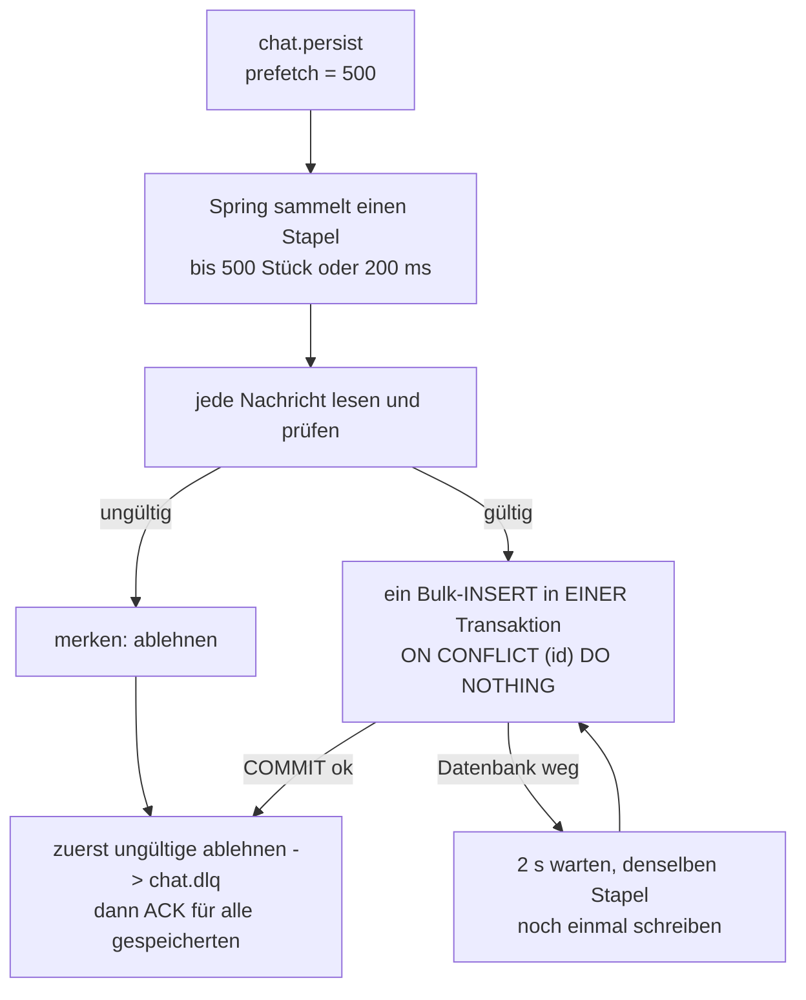

# Spezifikation: batch-writer

**Modul M321 · Klasse IT3c · Bewertung 1 · Stand 02.10.2026**

Der `batch-writer` holt die Nachrichten aus der Queue `chat.persist` und schreibt sie dauerhaft
in PostgreSQL. Er ist Schritt 4 der Umsetzungsreihenfolge in [`PLANUNG.md`](../PLANUNG.md).

Massstab für dieses Dokument: Eine Mitschülerin kann den Dienst allein aus dieser Spezifikation
bauen, ohne nachzufragen. Darum steht bei jeder Entscheidung auch, *warum* sie so gefallen ist.

---

## 1. Zweck und Abgrenzung

### 1.1 Was der Dienst tut

1. Er hängt als Verbraucher an der Queue `chat.persist`.
2. Er sammelt Nachrichten zu einem **Stapel** (bis 500 Stück oder 200 ms).
3. Er schreibt den ganzen Stapel in **einer** Datenbank-Transaktion in die Tabelle `message`.
4. Erst **nach** dem COMMIT bestätigt er die Nachrichten bei RabbitMQ (ACK).
5. Nachrichten, die sich nie speichern lassen (kaputtes JSON, fehlende Felder), legt er in die
   Dead-Letter-Queue `chat.dlq`, damit sie den Rest nicht blockieren.

Warum es ihn gibt: PLANUNG.md rechnet mit 1'667 Nachrichten pro Sekunde. Einzeln geschrieben
wären das 1'667 Transaktionen pro Sekunde. Mit Stapeln von 500 sind es rund 3,3. Der
batch-writer ist der Ort, an dem diese Rechnung Wirklichkeit wird.

### 1.2 Was der Dienst bewusst nicht tut

| Nicht Teil des Dienstes | Warum nicht |
|---|---|
| Chat-Historie lesen, REST-Schnittstelle | Der batch-writer ist ein reiner Schreiber. Gelesen wird später im `chat-service` (PLANUNG.md 3.1). Er braucht deshalb **keinen** HTTP-Port |
| Räume und Mitgliedschaften (`room`, `room_member`) | Nicht Teil dieser Aufgabe. Darum gibt es auch keinen Fremdschlüssel auf `room` (siehe 4.2) |
| Prüfen, ob der Absender im Raum sein darf | Das hat der chat-service vor dem Einreihen zu entscheiden. Was in `chat.persist` liegt, ist angenommen |
| Inhalte ändern, kürzen, filtern | Der batch-writer speichert, was der chat-service angenommen hat, Zeichen für Zeichen |
| Nachrichten aus `chat.dlq` erneut einspielen | Die DLQ ist ein Abstellgleis zur Kontrolle von Hand. Ein automatisches Wiedereinspielen würde kaputte Nachrichten im Kreis schicken |
| Exactly-once | Verteilte Systeme geben das so nicht her. Wir garantieren **at-least-once** und machen Duplikate harmlos (siehe 3.4) |
| Keycloak, Token prüfen | Der Dienst ist von aussen nicht erreichbar und nimmt keine Anfragen an |

---

## 2. Vertrag: was auf der Queue ankommt

### 2.1 Die Queue

| Eigenschaft | Wert | Beleg |
|---|---|---|
| Name | `chat.persist` | `chat-service/.../config/QueueNames.java` |
| Typ | klassische Queue, `durable` | `RabbitConfig.java:28` (`QueueBuilder.durable`) |
| Argument `x-dead-letter-exchange` | `""` (Standard-Exchange) | `RabbitConfig.java:29` |
| Argument `x-dead-letter-routing-key` | `chat.dlq` | `RabbitConfig.java:30` |
| Dead-Letter-Queue | `chat.dlq`, `durable`, ohne Argumente | `RabbitConfig.java:37` |
| Wie sie hineinkommt | Standard-Exchange `""`, Routing-Key `chat.persist` | `MessagePublisher.java:35` (`convertAndSend(PERSIST_QUEUE, message)`) |

**Der batch-writer deklariert beide Queues selbst, mit genau denselben Argumenten.** Grund:
Startet der batch-writer vor dem chat-service, gäbe es die Queue sonst noch nicht und der
Verbraucher könnte sich nicht anhängen. Die Argumente müssen *exakt* gleich sein. Weicht nur
eines ab, lehnt RabbitMQ die zweite Deklaration mit `PRECONDITION_FAILED` ab und der Dienst
kommt nicht hoch.

Was mit `reject(requeue=false)` abgelehnt wird, schickt RabbitMQ wegen dieser beiden Argumente
automatisch nach `chat.dlq`. Der batch-writer muss die DLQ also nie selbst beschreiben.

### 2.2 Der Inhalt (Body)

Der chat-service baut einen `ChatMessage`-record (`dto/ChatMessage.java:14`) und schickt ihn mit
dem `Jackson2JsonMessageConverter` (`RabbitConfig.java:61`). Der Converter benutzt den
ObjectMapper von Spring Boot.

Ein echtes Beispiel, mit genau diesem Converter und dem ObjectMapper von Spring Boot erzeugt
(Zeilenumbrüche nur zur Lesbarkeit):

```json
{
  "id": "49079faf-750a-463e-a8d7-f42d0235a307",
  "roomId": "b9956566-5ff2-483b-a258-e1b49b4e776f",
  "senderId": "anna",
  "senderName": "Anna Muster",
  "content": "Hallo",
  "sentAt": "2026-10-02T12:53:49.852631700Z"
}
```

| Feld | JSON-Typ | Bedeutung | Woher |
|---|---|---|---|
| `id` | String, UUID | Nachrichten-ID, **vom Server vergeben** | `MessageService.java:38`, `UUID.randomUUID()` |
| `roomId` | String, UUID | Raum der Nachricht | vom Aufrufer, `@NotNull` |
| `senderId` | String | `sub` aus Keycloak | vom Aufrufer, `@NotBlank` |
| `senderName` | String | Anzeigename, denormalisiert | vom Aufrufer, `@NotBlank` |
| `content` | String | Nachrichtentext | vom Aufrufer, `@NotBlank` |
| `sentAt` | String, ISO-8601 in UTC | Server-Zeitstempel | `MessageService.java:39`, `Instant.now()` |

**Woher ich das weiss**, in drei Schritten:

1. Aus dem Quelltext des chat-service, Zeilen wie oben angegeben.
2. Ausprobiert: ein kleines Java-Programm hat mit dem `Jackson2JsonMessageConverter` und dem
   ObjectMapper aus `JacksonAutoConfiguration` eine Nachricht erzeugt. Das Beispiel oben ist die
   echte Ausgabe. Wichtig dabei: **Mit einem nackten ObjectMapper käme `sentAt` als Zahl**
   (`1790945611.436501400`). Erst Spring Boot schaltet `WRITE_DATES_AS_TIMESTAMPS` aus und macht
   daraus Text. Der batch-writer muss deshalb **beide** Formen lesen können.
3. Im laufenden Stack nachsehen, ohne die Nachricht zu verbrauchen:
   ```bash
   docker compose stop batch-writer
   # eine Nachricht über POST /messages schicken (Befehl in Abschnitt 6, S3)
   docker compose exec rabbitmq rabbitmqadmin -u chat -p <passwort> \
     get queue=chat.persist ackmode=reject_requeue_true
   docker compose start batch-writer
   ```

### 2.3 Die Eigenschaften (Header)

| Eigenschaft | Wert vom chat-service | Was der batch-writer damit macht |
|---|---|---|
| `content_type` | `application/json` | nichts. Er liest den Body immer als JSON |
| `content_encoding` | `UTF-8` | nichts. JSON ist laut Standard UTF-8 |
| `delivery_mode` | `2` (persistent) | nichts. Wirkt im Broker: die Nachricht überlebt einen Neustart |
| Header `__TypeId__` | `ch.benedict.m321.chatservice.dto.ChatMessage` | **wird ignoriert** |

**Warum `__TypeId__` ignoriert wird:** Der Header nennt eine Java-Klasse aus einem *anderen*
Dienst. Die gibt es im batch-writer nicht, und es soll sie auch nicht geben (siehe Kommentar in
`ChatMessage.java`: «der Vertrag ist das JSON, nicht diese Klasse»). Szenario S5 legt Nachrichten
ausserdem **nur** mit `content_type` in die Queue. Wer sich auf `__TypeId__` verlässt, fällt dort
durch. Deshalb nimmt der batch-writer die rohe AMQP-Nachricht entgegen und wandelt den Body selbst
mit dem ObjectMapper in seinen **eigenen** record `ChatMessage` um. Der Zieltyp steht im Code,
nicht im Header.

### 2.4 Wann eine Nachricht gültig ist

Der batch-writer ist ein **toleranter Leser**: Er prüft nur, was die Datenbank sonst ablehnen
würde. Was der chat-service fachlich prüft (z. B. leerer Text), prüft er nicht noch einmal.

| Regel | Grund |
|---|---|
| Body ist gültiges JSON | sonst gibt es nichts zu speichern |
| alle sechs Felder vorhanden und nicht `null` | jede Spalte ist `NOT NULL` |
| `id` und `roomId` sind UUIDs | Spaltentyp `UUID` |
| `sentAt` ist ISO-8601-Text **oder** eine Zahl (Sekunden seit 1970) | siehe 2.2, Punkt 2 |
| `senderId` und `senderName` höchstens 255 Zeichen | Spaltentyp `VARCHAR(255)` |
| unbekannte zusätzliche Felder | **erlaubt**, werden ignoriert. So bricht der batch-writer nicht, wenn der chat-service später ein Feld dazunimmt |

Eine ungültige Nachricht geht sofort nach `chat.dlq` (siehe 3.6).

---

## 3. Verhalten

### 3.1 Normalfall



1. **Abholen.** Der Listener-Container von Spring AMQP holt Nachrichten mit `prefetch = 500`.
   Prefetch heisst: RabbitMQ schickt höchstens 500 unbestätigte Nachrichten an diesen Verbraucher.
   Prefetch muss mindestens so gross sein wie der Stapel, sonst kann der Stapel nie voll werden.
2. **Sammeln.** Spring ruft unsere Methode mit einer `List<Message>` auf, sobald 500 Nachrichten
   da sind oder die Sammelzeit abgelaufen ist. Dafür gibt es in Spring AMQP zwei Einstellungen,
   und beide stehen auf `BATCH_TIMEOUT_MS` (200 ms):
   - `receiveTimeout`: so lange wartet Spring höchstens auf die *nächste* Nachricht.
   - `batchReceiveTimeout`: so lange darf das Sammeln *insgesamt* dauern.

   Die Uhr läuft ab Beginn des Sammelns, nicht erst ab der ersten Nachricht (nachgelesen im
   Quelltext von `SimpleMessageListenerContainer`, Methode `doReceiveAndExecute`). Ein Stapel ist
   also spätestens nach etwa 200 bis 400 ms fertig, auch wenn nur wenig Verkehr ist.
3. **Prüfen.** Jede Nachricht wird nach 2.4 gelesen. Ungültige werden zum Ablehnen vorgemerkt.
4. **Schreiben.** Alle gültigen Nachrichten gehen mit `JdbcTemplate.batchUpdate` in **einer**
   Transaktion (`@Transactional`) in die Tabelle:
   ```sql
   INSERT INTO message (id, room_id, sender_id, sender_name, content, sent_at)
   VALUES (?, ?, ?, ?, ?, ?)
   ON CONFLICT (id) DO NOTHING
   ```
5. **Bestätigen**, erst nach dem COMMIT und in dieser Reihenfolge:
   1. jede ungültige Nachricht einzeln mit `basicReject(tag, requeue=false)`, dadurch landet sie
      in `chat.dlq`;
   2. dann **ein** `basicAck(höchster Tag der gespeicherten, multiple=true)` für alle gespeicherten.

   Die Reihenfolge ist wichtig. `multiple=true` bestätigt *alle* noch offenen Nachrichten bis zu
   diesem Tag. Stünde eine ungültige Nachricht mit kleinerem Tag noch offen, würde sie mitbestätigt
   und wäre verloren statt in der DLQ.

**Bestätigungsart: manuell** (`AcknowledgeMode.MANUAL`). Nur so entscheidet unser Code, *wann*
bestätigt wird, und das ist genau der Kern von at-least-once: **kein ACK vor dem COMMIT.**

**Ein Verbraucher pro Instanz** (`concurrency = 1`). Das hält die Delivery-Tags eines Stapels
lückenlos in Reihenfolge, und `multiple=true` ist sicher. Mehr Durchsatz holt man durch mehr
Instanzen (`--scale`), nicht durch mehr Threads.

### 3.2 S3: Last, 1000 Nachrichten

1000 Nachrichten ergeben zwei bis wenige Stapel. Das Schreiben dauert Millisekunden. Die Grenze
von 60 s ist kein Thema, Engpass ist eher das Senden selbst.

### 3.3 S4: batch-writer war gestoppt, 1000 Nachrichten warten

- Während der batch-writer steht, bleiben die Nachrichten in `chat.persist`. Die Queue ist
  `durable` und die Nachrichten sind persistent, also geht nichts verloren.
- Beim Start schickt RabbitMQ sofort 500 Nachrichten (prefetch). Der erste Stapel ist in wenigen
  Millisekunden voll, der zweite gleich danach.
- **Erwartet: 2 Schreib-Transaktionen für 1000 Nachrichten.** Liefert RabbitMQ einmal langsamer,
  als gesammelt wird, wird ein Stapel kleiner und es werden ein paar mehr. Dazu kommen beim Start
  die Abfragen von Flyway, ob das Schema aktuell ist, grob 10 bis 20 kurze Transaktionen. Die
  Obergrenze von 100 hat damit viel Abstand.
- Damit nichts im Hintergrund Transaktionen erzeugt, ist der Verbindungspool klein
  (höchstens 2 Verbindungen, siehe 5.2). Es gibt keine Abfragen nach Zeitplan.

### 3.4 S5: Dieselbe Nachricht kommt zweimal

- Der Primärschlüssel ist `message.id`, die ID vergibt der chat-service.
- `ON CONFLICT (id) DO NOTHING` lässt die zweite Zeile einfach weg. Das ist **kein Fehler**:
  Die Nachricht ist ja gespeichert. Darum wird sie normal bestätigt und landet **nicht** in
  `chat.dlq`.
- Das gilt auch, wenn beide Kopien im **selben** Stapel sind (die zweite Anweisung derselben
  Transaktion sieht die erste Zeile) und wenn zwei Instanzen sie **gleichzeitig** schreiben
  (die zweite Transaktion wartet auf die erste und lässt die Zeile dann weg).
- Woher kommen Duplikate im echten Betrieb? Der batch-writer stürzt nach dem COMMIT, aber vor
  dem ACK ab. RabbitMQ liefert den Stapel dann erneut aus. Das ist der Preis von at-least-once,
  und genau dafür ist `ON CONFLICT` da.
- Das Log meldet pro Stapel, wie viele Zeilen neu waren und wie viele Duplikate übersprungen
  wurden (`batchUpdate` liefert pro Zeile `1` oder `0` zurück).

### 3.5 S6: Zwei Instanzen

- Beide Instanzen hängen an **derselben** Queue `chat.persist`. RabbitMQ verteilt reihum, jede
  Nachricht geht an genau einen Verbraucher. Das ist **Competing Consumers** (PLANUNG.md 3.5).
- Jede Instanz hat ihren eigenen Prefetch von 500. Bei 1000 Nachrichten bekommt jede einen Teil.
- Kommt trotzdem eine Nachricht bei beiden an (z. B. weil eine Instanz während des Stapels stirbt
  und RabbitMQ neu ausliefert), verhindert der Primärschlüssel die doppelte Zeile (3.4).
- Starten beide Instanzen gleichzeitig, wollen beide das Schema anlegen. Flyway nimmt dafür eine
  Sperre in PostgreSQL (Advisory Lock). Die zweite Instanz wartet, sieht dann, dass alles da ist,
  und macht nichts.
- In `docker-compose.yml` steht deshalb **kein** `container_name` beim batch-writer, sonst
  liesse er sich nicht skalieren.

### 3.6 Ungültige Nachrichten (Giftnachrichten)

Eine Nachricht, die sich *nie* speichern lässt, darf den Rest nicht aufhalten.

| Fall | Erkannt | Reaktion |
|---|---|---|
| kein gültiges JSON, Feld fehlt, keine UUID, Name zu lang | beim Lesen (2.4) | sofort `reject(requeue=false)` → `chat.dlq`, Warnung im Log mit Grund |
| Datenbank lehnt den Inhalt ab, z. B. ein Nullzeichen `\u0000` im Text (PostgreSQL erlaubt das in `TEXT` nicht) | beim Schreiben: `DataIntegrityViolationException` | der Stapel wird **einzeln** wiederholt, jede Nachricht in eigener Transaktion. Nur die abgelehnte geht nach `chat.dlq`, alle anderen werden gespeichert |

Warum nicht `requeue=true`? Dann käme dieselbe kaputte Nachricht sofort wieder, scheiterte
wieder, und so weiter: eine Endlosschleife, die die Queue verstopft. Die DLQ ist genau für
Nachrichten da, bei denen Warten nichts ändert.

Der Rückfall auf Einzel-Inserts kostet bis zu 500 Transaktionen, aber nur im seltenen Fehlerfall.
Im Normalfall bleibt es bei einer.

### 3.7 S7: Die Datenbank ist weg

**Regel: Ist die Datenbank nicht erreichbar, bleibt der Stapel unbestätigt. Der batch-writer
wartet `DB_RETRY_DELAY_MS` (2 s) und schreibt denselben Stapel noch einmal, so lange, bis es
klappt.**

- Erkannt wird das an jeder `DataAccessException` (ausser `DataIntegrityViolationException`, siehe
  3.6) und an jeder `TransactionException`. Die zweite ist nötig, weil `@Transactional` schon beim
  *Öffnen* der Transaktion eine Verbindung braucht. Fehlt die Datenbank, kommt dort eine
  `CannotCreateTransactionException`, und die ist keine `DataAccessException`.
- Der Verbindungspool wartet höchstens `connection-timeout = 5 s` auf eine Verbindung. So meldet
  sich der Fehler schnell, und das Log zeigt jeden Versuch.
- Während gewartet wird, holt dieser Verbraucher nichts Neues ab. Neue Nachrichten bleiben sicher
  in `chat.persist`, höchstens 500 liegen unbestätigt beim batch-writer.
- Kommt PostgreSQL zurück, baut der Pool (HikariCP) selbst neue Verbindungen auf. Der nächste
  Versuch gelingt, danach wird bestätigt. **Kein Neustart von Hand nötig, der Prozess läuft die
  ganze Zeit weiter.**
- Rechnung für S7: Postgres ist 15 s weg, dazu ein paar Sekunden Startzeit. Bei einem Versuch
  alle 2 bis 7 s sind die 300 Nachrichten nach rund 20 bis 30 s in der Tabelle, weit unter 90 s.
- **Wohin die 300 Nachrichten in S7 gehen: in die Tabelle `message`. Nicht in die DLQ.** Die
  Nachrichten sind ja in Ordnung, nur die Datenbank fehlt. Würde man sie in die DLQ legen, müsste
  sie jemand von Hand zurückspielen.

Verworfene Alternativen:

| Alternative | Warum nicht |
|---|---|
| `basicNack(requeue=true)` sofort | RabbitMQ liefert sofort wieder aus. Das ist eine heisse Schleife, die tausendfach pro Sekunde scheitert, das Log flutet und CPU frisst |
| nach N Versuchen in die DLQ | Eine Datenbank, die 30 s weg ist, würde gültige Nachrichten ins Abstellgleis schieben |
| Prozess beenden und von Docker neu starten lassen | Funktioniert auch (unbestätigte Nachrichten kommen zurück), ist aber langsamer, und S7 verlangt ausdrücklich, dass der Dienst ohne Neustart weiterläuft |

Als zweite Sicherung steht in `docker-compose.yml` `restart: unless-stopped`. Stürzt der Prozess
doch einmal ab, sind die unbestätigten Nachrichten nicht verloren. RabbitMQ liefert sie neu aus,
sobald die Verbindung weg ist.

### 3.8 Weitere Fehlerfälle

| Fall | Verhalten | Begründung |
|---|---|---|
| RabbitMQ beim Start nicht erreichbar | Spring AMQP versucht es alle 5 s neu, der Prozess läuft weiter | Kein Absturz wegen einer Reihenfolge beim Hochfahren |
| RabbitMQ startet neu | Spring AMQP verbindet sich neu. Unbestätigte Nachrichten liefert RabbitMQ erneut aus | at-least-once, Duplikate fängt 3.4 ab |
| Verbindung zu RabbitMQ reisst zwischen COMMIT und ACK | Die Nachrichten kommen erneut, `ON CONFLICT` überspringt sie | genau der Fall, für den die Idempotenz da ist |
| `docker compose stop batch-writer` mitten im Stapel | Spring hört auf abzuholen. Was noch unbestätigt ist, gibt RabbitMQ beim Schliessen der Verbindung an die Queue zurück | nichts geht verloren |
| Unerwarteter Programmfehler (Bug) im Listener | Log-Eintrag auf `ERROR`, `basicNack(requeue=true)` für den ganzen Stapel | Bei `MANUAL` bestätigt Spring nie von selbst. Ohne Nack blieben die Nachrichten bis zum Verbindungsende hängen und der Verbraucher stünde still |
| Tabelle fehlt oder SQL falsch | wird wie «Datenbank weg» behandelt, also warten und wiederholen, mit Warnung im Log | Die Nachrichten sind in Ordnung. Sobald jemand das Schema repariert, läuft es weiter |

---

## 4. Datenmodell

### 4.1 Tabelle `message`

Spalten wie in PLANUNG.md Abschnitt 3.7:

```sql
CREATE TABLE message (
    id          UUID         PRIMARY KEY,
    room_id     UUID         NOT NULL,
    sender_id   VARCHAR(255) NOT NULL,
    sender_name VARCHAR(255) NOT NULL,
    content     TEXT         NOT NULL,
    sent_at     TIMESTAMPTZ  NOT NULL
);

CREATE INDEX message_room_id_sent_at_idx ON message (room_id, sent_at DESC);
```

### 4.2 Entscheide und Begründungen

| Entscheid | Begründung |
|---|---|
| `id` ist Primärschlüssel, kein `SERIAL` | Die ID kommt aus dem chat-service. Nur wenn die Datenbank *diese* ID kennt, erkennt sie ein Duplikat (3.4). Eine eigene Zählnummer würde jedes Duplikat als neue Zeile speichern |
| **kein** Fremdschlüssel `room_id → room(id)` | Räume sind nicht Teil dieser Aufgabe, und niemand legt sie an. Mit Fremdschlüssel würde **jede** Nachricht abgelehnt. Das ist eine bewusste Abweichung vom ER-Diagramm in PLANUNG.md 3.7. Kommen Räume dazu, wird der Fremdschlüssel in einer neuen Migration nachgezogen, zusammen mit der Frage, was mit Nachrichten an unbekannte Räume passiert |
| Index `(room_id, sent_at DESC)` | Aus PLANUNG.md 3.7: die einzige Abfrage im Lesepfad ist «die letzten 50 Nachrichten eines Raums». Der Preis: jede neue Zeile muss in zwei Indizes eingetragen werden (Primärschlüssel und dieser). Das ist bei 3 Stapeln pro Sekunde tragbar |
| `TIMESTAMPTZ` | Der Zeitstempel ist ein Zeitpunkt (`Instant`, UTC). PostgreSQL speichert auf Mikrosekunden genau. Was der chat-service feiner liefert (Nanosekunden), wird gerundet. Für die Reihenfolge in einem Chat reicht das |
| `VARCHAR(255)` für Absender | Eine Keycloak-`sub` ist eine UUID mit 36 Zeichen. 255 lässt Luft und begrenzt Unsinn |
| `TEXT` für den Inhalt | Keine Längengrenze in der Datenbank. Wie lang eine Nachricht sein darf, ist eine fachliche Regel und gehört in den chat-service |
| `room` und `room_member` werden **nicht** angelegt | Nicht Teil der Aufgabe. Eine Tabelle ohne Code, der sie benutzt, wäre eine Vorrats-Abstraktion |

**UUID-Version:** PLANUNG.md spricht von zeitsortierten UUIDs. Der chat-service vergibt heute
aber `UUID.randomUUID()`, also Version 4 (zufällig, `MessageService.java:38`). Für den
batch-writer ändert das nichts, er speichert jede UUID. Es ist ein offener Punkt für den
chat-service (Abschnitt 7).

### 4.3 Wo das Schema entsteht

**Flyway im batch-writer**, beim Start, aus
`batch-writer/src/main/resources/db/migration/V1__create_message_table.sql`.

Wie es funktioniert, in zwei Sätzen: Flyway führt in der Tabelle `flyway_schema_history` Buch,
welche SQL-Dateien schon gelaufen sind. Beim Start führt es nur die neuen aus, in der Reihenfolge
ihrer Versionsnummer.

| Warum so | |
|---|---|
| Der batch-writer ist der **einzige Schreiber** der Tabelle | Wer die Tabelle beschreibt, ist auch für ihre Form verantwortlich |
| Tests bekommen **dasselbe** Schema | Flyway läuft auch im Test gegen den Testcontainer. Es gibt keine zweite Kopie, die auseinanderlaufen kann |
| Änderungen sind nachvollziehbar | Jede Änderung ist eine neue Datei `V2__...`, und das Git-Log zeigt sie |
| mehrere Instanzen | Flyway sperrt mit einem Advisory Lock, siehe 3.5 |

Verworfen:

| Alternative | Warum nicht |
|---|---|
| SQL-Datei in `/docker-entrypoint-initdb.d` des Postgres-Containers | läuft nur bei einem **leeren** Volume, nie wieder danach. Im Test müsste man sie getrennt einspielen |
| eigener `migrate`-Container | ein Dienst mehr, der sich nach getaner Arbeit beendet. In `docker compose ps` steht er dann als `exited`, und S2 verlangt «alle Dienste laufen» |
| `spring.sql.init` | kennt keine Versionen und läuft bei jedem Start erneut |

---

## 5. Konfiguration

### 5.1 Umgebungsvariablen

Alle Werte kommen über `docker-compose.yml` aus `.env`. Im Repository steht nur `.env.example`
mit Beispielwerten, die echte `.env` steht in `.gitignore`.

| Variable | Wer sie braucht | Beispielwert | Vorgabe ohne Variable | Zweck |
|---|---|---|---|---|
| `POSTGRES_USER` | postgres, batch-writer | `chat` | `chat` | Datenbank-Benutzer. Das Postgres-Image legt ihn beim ersten Start an |
| `POSTGRES_PASSWORD` | postgres, batch-writer | `bitte-lokal-aendern` | leer | Passwort dazu |
| `POSTGRES_DB` | postgres, batch-writer | `chat` | `chat` | Name der Datenbank |
| `POSTGRES_HOST` | batch-writer | – (in Compose fest `postgres`) | `localhost` | Hostname der Datenbank |
| `RABBITMQ_HOST` | batch-writer | – (in Compose fest `rabbitmq`) | `localhost` | Hostname des Brokers |
| `RABBITMQ_USER` | rabbitmq, chat-service, batch-writer | `chat` | `guest` | gibt es schon |
| `RABBITMQ_PASSWORD` | rabbitmq, chat-service, batch-writer | `bitte-lokal-aendern` | `guest` | gibt es schon |
| `BATCH_SIZE` | batch-writer | `500` | `500` | höchstens so viele Nachrichten pro Stapel, zugleich der Prefetch |
| `BATCH_TIMEOUT_MS` | batch-writer | `200` | `200` | so lange wird höchstens gesammelt (3.1, Punkt 2) |
| `DB_RETRY_DELAY_MS` | batch-writer | `2000` | `2000` | Pause zwischen zwei Schreibversuchen, wenn die Datenbank weg ist |

Die Postgres-Variablen heissen absichtlich genau so wie beim offiziellen Postgres-Image. Dieselbe
Zeile in `.env` stellt damit den Container *und* den batch-writer ein.

### 5.2 Feste Einstellungen (in `application.yml`)

| Einstellung | Wert | Warum |
|---|---|---|
| `spring.datasource.hikari.maximum-pool-size` | `2` | ein Listener-Thread braucht eine Verbindung, eine Reserve. Mehr Verbindungen würden nur Leerlauf und Hintergrund-Transaktionen erzeugen |
| `spring.datasource.hikari.minimum-idle` | `1` | |
| `spring.datasource.hikari.connection-timeout` | `5000` ms | Fehler schnell melden, statt 30 s still zu warten (3.7) |
| Listener `concurrency` | `1` | siehe 3.1 |
| Listener `acknowledgeMode` | `MANUAL` | siehe 3.1 |
| Listener `prefetch` | = `BATCH_SIZE` | siehe 3.1, Punkt 1 |

### 5.3 Docker

| Dienst | Image | Netz | Ports | Abhängigkeiten |
|---|---|---|---|---|
| `postgres` | `postgres:16-alpine` (PLANUNG.md 2.1: PostgreSQL 16) | `chat-net` | **keine** | – , Healthcheck `pg_isready`, Volume `postgres-data` |
| `batch-writer` | eigenes `batch-writer/Dockerfile` (Maven bauen, dann JRE 21) | `chat-net` | **keine** | `rabbitmq` und `postgres` *healthy*, `restart: unless-stopped` |

Der batch-writer hat keinen HTTP-Port, auch intern nicht. Er spricht nur nach aussen zu RabbitMQ
und PostgreSQL.

---

## 6. Abnahmekriterien

Alle Befehle laufen in Git Bash oder einer Linux-Shell im Wurzelverzeichnis, bei laufendem Stack.
Gemessen wird wie im Auftrag **von innen**, mit `psql` im Postgres-Container und `rabbitmqctl` im
RabbitMQ-Container. Das Skript [`scripts/szenarien.sh`](../scripts/szenarien.sh) führt S2 bis S8
in dieser Reihenfolge auf demselben Stack aus und meldet je Szenario `BESTANDEN` oder
`NICHT BESTANDEN`.

Hilfsbefehle, die unten benutzt werden:

```bash
set -a; source .env; set +a                 # Variablen aus .env laden

sql() {                                     # eine SQL-Abfrage, nur das Ergebnis
  docker compose exec -T postgres psql -U "$POSTGRES_USER" -d "$POSTGRES_DB" -tA -c "$1"
}

queue() {                                   # Name, Nachrichten, Verbraucher je Queue
  docker compose exec -T rabbitmq rabbitmqctl list_queues -q name messages consumers
}

send() {                                    # $1 Anzahl, $2 Raum-ID
  docker run --rm --network chat-net curlimages/curl sh -c "
    for i in \$(seq 1 $1); do
      curl -s -o /dev/null -X POST http://chat-service:8080/messages \
        -H 'Content-Type: application/json' \
        -d '{\"roomId\":\"$2\",\"senderId\":\"anna\",\"senderName\":\"Anna\",\"content\":\"Nachricht '\$i'\"}'
    done"
}
```

Jedes Szenario benutzt eine **eigene Raum-ID**. So zählt `WHERE room_id = '...'` nur die
Nachrichten dieses Szenarios, obwohl alle auf demselben Stack ohne Aufräumen laufen.

| Nr | Kriterium (messbar) | Befehl | Bestanden, wenn |
|---|---|---|---|
| S1 | alle Tests grün, ein Lauf | `mvn clean test` | `BUILD SUCCESS`, `Failures: 0, Errors: 0` in beiden Modulen |
| S2 | alle Dienste laufen | `cp .env.example .env && docker compose up -d --build`, dann `docker compose ps --format '{{.Service}} {{.State}}'` | `rabbitmq`, `chat-service`, `postgres`, `batch-writer` stehen auf `running` |
| S2 | kein Port veröffentlicht | `docker compose ps --format '{{.Service}} {{.Ports}}' \| grep -c -- '->'` | `0` |
| S2 | Tabelle da | `sql "\d message"` | sechs Spalten wie in 4.1 |
| S3 | 1000 in der Tabelle, ≤ 60 s | `send 1000 $RAUM`, dann alle 2 s `sql "SELECT count(*) FROM message WHERE room_id='$RAUM'"` | `1000` innerhalb von 60 s |
| S3 | Queue leer | `queue \| grep chat.persist` | `chat.persist  0  1` |
| S4 | nichts verloren | `docker compose stop batch-writer`, `send 1000 $RAUM`, `docker compose start batch-writer`, Zählung wie S3 | `1000` |
| S4 | ≤ 100 Transaktionen | vor dem Start und nach dem Schreiben (plus 12 s, bis die Statistik nachgeführt ist): `sql "SELECT xact_commit + xact_rollback FROM pg_stat_database WHERE datname = current_database()"` | Differenz ≤ 100 (erwartet: unter 30) |
| S4 | Stapel wirklich gross | `sql "SELECT count(DISTINCT xmin::text) FROM message WHERE room_id='$RAUM'"` | ≤ 5. `xmin` ist die Nummer der Transaktion, die eine Zeile geschrieben hat. Das zählt *genau* die Schreib-Transaktionen |
| S5 | genau eine Zeile | dieselbe JSON-Nachricht (Format 2.2, feste `id`) zweimal: `docker compose exec -T rabbitmq rabbitmqadmin -u "$RABBITMQ_USER" -p "$RABBITMQ_PASSWORD" publish exchange=amq.default routing_key=chat.persist properties='{"content_type":"application/json"}' payload="$JSON"`, dann `sql "SELECT count(*) FROM message WHERE id='$ID'"` | `1` |
| S5 | DLQ leer | `queue \| grep chat.dlq` | `chat.dlq  0  0` |
| S6 | zwei Verbraucher | `docker compose up -d --scale batch-writer=2`, dann `queue \| grep chat.persist` | dritte Spalte `2` |
| S6 | alle da, keine doppelt | `send 1000 $RAUM`, dann `sql "SELECT count(*), count(DISTINCT content) FROM message WHERE room_id='$RAUM'"` | `1000\|1000` |
| S6 | beide arbeiten | `docker compose logs batch-writer \| grep 'Stored batch'` | Zeilen von `batch-writer-1` *und* `batch-writer-2` |
| S7 | nichts verloren, ≤ 90 s | `docker compose stop postgres`, `send 300 $RAUM`, 15 s warten, `docker compose start postgres`, Zählung wie S3 | `300` innerhalb von 90 s nach dem Start von Postgres |
| S7 | DLQ leer | `queue \| grep chat.dlq` | `chat.dlq  0  0` |
| S7 | kein Neustart | `docker inspect -f '{{.RestartCount}} {{.State.StartedAt}}' $(docker compose ps -q batch-writer)` | Neustart-Zähler `0`, Startzeit vor dem Postgres-Stopp |
| S8 | keine Streams | `grep -rnE '\.stream\(\|Stream\.of\|Collectors\.' batch-writer/src` | keine Treffer |
| S8 | Kommentar über jeder Klasse und Methode | Sichtprüfung. Hilfe: `grep -rn -B1 -E '^\s*(public\|private\|protected\|static\|void\|class\|record)' batch-writer/src --include=*.java` | über jeder Deklaration steht `*/` oder eine Annotation, darüber ein Kommentar |
| S8 | `.env` nicht im Repo | `git ls-files .env` | keine Ausgabe |

---

## 7. Abweichungen von PLANUNG.md und offene Punkte

| # | Punkt | Stand |
|---|---|---|
| 1 | kein Fremdschlüssel auf `room` | bewusste Abweichung, siehe 4.2 |
| 2 | chat-service vergibt UUID v4 statt zeitsortierter UUID | ausserhalb dieses Dienstes. Für die Speicherung egal, für die Index-Leistung bei Millionen Zeilen nicht (PLANUNG.md nennt das Problem) |
| 3 | «200 ms» heisst bei uns: höchstens rund 200 bis 400 ms ab Beginn des Sammelns | Folge davon, wie Spring AMQP zählt (3.1). Für die Lastrechnung ohne Bedeutung |
| 4 | Ist die Datenbank länger als 30 min weg, schliesst RabbitMQ den Kanal wegen `consumer_timeout` | Die Nachrichten gehen dann zurück in die Queue, Spring verbindet sich neu. Nichts geht verloren, aber das Log wird laut |
| 5 | DLQ wird nicht ausgewertet | Kontrolle von Hand: `docker compose exec rabbitmq rabbitmqadmin -u ... -p ... get queue=chat.dlq count=10` |
| 6 | Wachstum 1,2 GB/h (PLANUNG.md 7, Punkt 2) | ungelöst, gehört nicht zu dieser Aufgabe |
